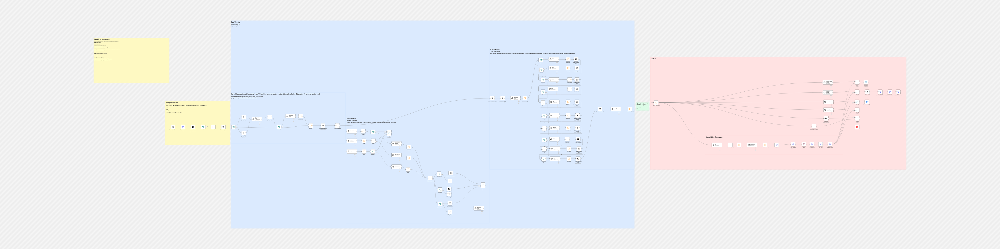

# AI Content Repurposing Engine

Turns one article into posts for specific audiences. It cleans the source text, improves it with an LLM, and rewrites it through copywriting frameworks (SCQA, PEEL, 5W1H, BAR, FAB, PREP, Pyramid, PAS, SOAR, AIDA). Brand, ethics and legal review passes run on the result. Platform prompters then shape it for LinkedIn, X, Facebook and Instagram, and a short-video branch adds text-to-speech and video rendering. Notion holds the state between stages.

Work in progress: the sticky notes inside the workflow mark which sections are still under construction.

## At a glance

- Nodes: 122
- Integrations: anthropic, elevenLabs, facebookGraphApi, googleDrive, httpRequest, linkedIn, microsoftSharePoint, notion, openAi, twitter, youTube

## Setup

1. In n8n, open **Workflows → Import from File** and select the JSON.
2. Create these credentials and select them on the nodes that need them: `anthropicApi`, `googleDriveOAuth2Api`, `microsoftSharePointOAuth2Api`, `notionApi`, `openAiApi`, `twitterOAuth1Api`, `twitterOAuth2Api`.
3. Replace the placeholders below with your own values.

## Placeholders

Values were removed from the export and replaced with:

- `YOUR_ANTHROPIC_ID`
- `YOUR_API_KEY`
- `YOUR_ELEVEN_LABS_ID`
- `YOUR_GOOGLE_DRIVE_ID`
- `YOUR_ID`
- `YOUR_MICROSOFT_SHARE_POINT_ID`
- `YOUR_NOTION_ID`
- `YOUR_X_HANDLE`
